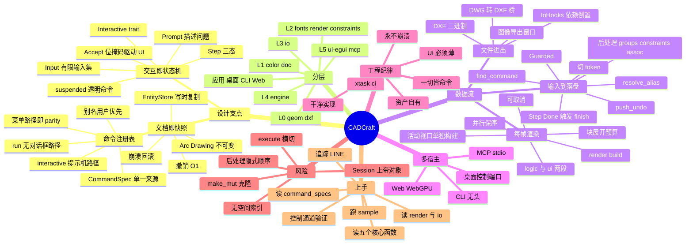

# CADCraft 架构脑图

> 三种形态任选：**Markmap**（直接渲染本文件第一节）· **Mermaid mindmap**（GitHub/Obsidian 原生）· **纯文本大纲**（导入 XMind/MindNode）。

---

## 一、Markmap 源码

```markdown
# CADCraft

## 设计支点

### 文档即快照
- DocState.doc 为 Arc Drawing
- EntityStore 写时复制
- Snapshot 只存指针
- 撤销 O 1
- 崩溃回滚 换回旧 Arc

### 命令注册表
- CommandSpec 单一行为来源
- run JSON 无对话框
- interactive 提示机
- menu 路径即 parity 指标
- 别名 用户优先于内置
- 30 多个 mod 的 specs 拼接
- 命令行菜单脚本CLIMCP 共用

### 交互即状态机
- Interactive trait
- begin prompt input preview drag
- Prompt 描述问题
- Accept 位掩码驱动 UI
- Input 有限输入集
- Step Continue Done Cancel
- suspended 单层实现透明命令

## 分层 L0 到 L5

### L0 基础
- geom 几何求交偏移
- dxf 标签读写 ASCII 与二进制

### L1 数据
- color ACI 真彩色
- doc Drawing EntityStore Space EntityKind Common
- foreign 保留未知数据

### L2 表现
- fonts 单笔画 TTF 整形 BiDi MTEXT
- render DisplayList build raster clip pen paper
- constraints DOF LM 表达式

### L3 IO
- read DWG 桥 DXF SVG
- write_with 版本 二进制
- 导出 PNG SVG PDF
- check_window 敌意校验

### L4 引擎
- Session DocState Settings
- Running LastUsed
- snap select grips assoc
- undoctl sysvars
- lisp 自研解释器
- guard panic 安全网

### L5 前端
- ui-egui CadApp 薄壳
- UiState 可序列化
- docking canvas cmdline control
- menus UI_COMMANDS
- theme Tokens i18n
- mcp Headless 与 Remote

### 应用
- cadcraft 桌面
- cadcraft-cli
- cadcraft-web

## 关键数据流

### 输入到落盘
- 切 token 空 token 即 Enter
- resolve_alias
- find_command
- enabled 前置检查
- Guarded 包 catch_unwind
- feed begin 与 input
- Step Done 触发 finish
- 后处理 groups constraints assoc
- push_undo Snapshot

### 每帧渲染
- logic LISP 时间片 主题 控制通道 后台打开
- ui 工具栏 状态栏 停靠面板 画布
- render build 生成 DisplayList
- 并行 256 一块 保序拼接
- 活动视口单独构建
- 块展开预算
- 构建可取消

### 文件进出
- DWG 转 DXF 桥
- SVG SVGZ 读
- DXF ASCII 与二进制
- 图像导出可指定窗口
- IoHooks 依赖倒置

## 多宿主一套内核

- 桌面 控制端口
- Web WebGPU WebGL2
- CLI 无头
- MCP stdio JSONRPC
- 工具 command_line execute inspect render screenshot

## 工程纪律

### 永不崩溃
- forbid unsafe
- clippy deny unwrap expect panic
- catch_unwind 安全网
- 敌意输入一律 get

### 干净实现
- 只黑盒观察 AutoCAD
- 不复用 Autodesk 资产
- 格式来自公开规范

### 资产自有
- 图标代码绘制
- 填充与线型自定义
- 字体自有
- ATTRIBUTION 强制

### 一切皆命令
### UI 必须薄
### 质量门禁 xtask ci

## 风险与机会

### 结构性风险
- Session 接近上帝对象
- execute 横切多职责
- 后处理顺序是隐式契约
- make_mut 克隆外壳
- 渲染无空间索引

### 上手成本
- cmd 下 80 多个文件
- draw modify annotate 巨型文件

### 改进机会
- 拆分 Session
- 后处理顺序断言测试
- 超大图纸 profiling
- 空间索引加速视口

## 上手路径

- 跑 sample 与 control
- 读 command_specs
- 读 execute start input feed finish
- 追踪 LINE 状态机
- 读 render 与 io
- 控制通道验证
```

---

## 二、Mermaid mindmap



---

## 三、纯文本大纲（导入 XMind / MindNode / FreeMind）

```text
CADCraft
├── 设计支点
│   ├── 文档即快照：Arc<Drawing> + EntityStore CoW + Snapshot 只存指针 → 撤销 O(1)、崩溃可回滚
│   ├── 命令注册表：CommandSpec{id,menu,aliases,run,interactive,undoable,transparent} 唯一行为来源
│   └── 交互状态机：Interactive + Prompt + Input + Step，Accept 位掩码驱动 UI
├── 分层
│   ├── L0 geom / dxf
│   ├── L1 color / doc
│   ├── L2 fonts / render / constraints
│   ├── L3 io
│   ├── L4 engine
│   ├── L5 ui-egui / mcp
│   └── apps cadcraft / cadcraft-cli / cadcraft-web
├── 数据流
│   ├── 输入：cmdline → resolve_alias → find_command → Guarded → feed → Step
│   ├── 收尾：finish → refuse_non_finite → after_command(groups→constraints→assoc) → push_undo
│   ├── 渲染：logic → ui → docking → canvas → render::build → DisplayList → GPU
│   └── 文件：io::read(内容识别) / io::write_with(版本+二进制) / IoHooks 依赖倒置
├── 多宿主：桌面控制端口 · Web(WebGPU/WebGL2) · CLI 无头 · MCP stdio
├── 纪律：永不崩溃 · 净室 · 资产自有 · 一切皆命令 · UI 薄 · xtask ci
├── 风险：Session 上帝对象 · execute 横切 · 后处理隐式顺序 · make_mut 克隆 · 无空间索引
└── 上手：跑 sample → 读 command_specs → 读五个核心函数 → 追 LINE → 读 render/io → 控制通道验证
```
